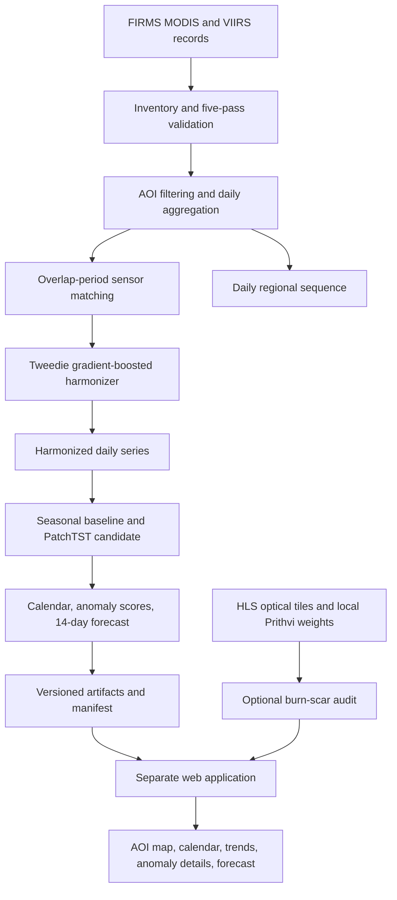

# Architecture and Technical Design

## Selected architecture

A modular spatio-temporal pipeline produces versioned analytical artifacts; a separate web application presents them. Kaggle is the isolated batch compute environment, not the public app host.

## Pillar 1 — sensor harmonization

Use processed FIRMS records and only fields actually available in the selected products. Candidate covariates include MODIS FRP, brightness temperature where available, scan/view geometry where available, local detection density, land cover, elevation, and temporal context.

Construct matched records during the sensor-overlap period. Specify temporal tolerance, spatial overlap, handling of multiple VIIRS detections within a MODIS footprint, duplicate policy, confidence filters, and target units before training. The primary candidate is LightGBM regression with a Tweedie objective; XGBoost may be compared if justified. Compare with identity and simple calibration baselines. Evaluate held-out chronological periods and report bias, error, subgroup performance, and detection-selection limitations.

Output harmonized daily estimates plus a manifest containing source versions, features, target definition, split boundaries, parameters, metrics, code revision, and hashes. Do not describe estimates as ground truth.

## Pillar 2 — calendar, anomalies, and forecast

Aggregate validated records into daily AOI sequences. Candidate channels include harmonized/observed FRP, active-pixel count, observation coverage/quality, and day-of-year encoding. Distinguish missing coverage from zero detections.

Build seasonal baselines and anomaly scoring first. PatchTST is the selected temporal-model candidate, with proposed initial settings (16-day patches, stride 8, dimension 128, four encoder blocks, eight heads, dropout 0.1) treated as tunable starting values rather than proven optimal settings. Compare against seasonal-naive and persistence baselines. Forecast probabilistic regional activity over a 14-day horizon; never forecast exact ignition coordinates/times. Any alert threshold must be validated and documented.

## Pillar 3 — optional Prithvi optical audit

Prithvi-EO 2.0 is used only with compatible HLS optical imagery and the correct local burn-scar checkpoint. It is not part of the active-fire thermal calibration path. Validate band order, scaling, spatial reference, nodata, date availability, checkpoint hash, and output alignment. If any required input is unavailable, the main application still works and the optional audit shows an explicit unavailable state.

## Artifact contracts

- **Observation records:** source/product/platform, timestamp, coordinates, FRP and units, available quality/confidence flags, source file ID/version.
- **Matched calibration records:** match/group ID, sensor IDs, timestamps, spatial relation, tolerances, feature fields, target definition, eligibility flags.
- **Daily AOI records:** AOI geometry/version, date, sensor coverage, counts, FRP aggregates, missingness and quality summary.
- **Calendar/forecast records:** date, observed/harmonized values, seasonal baseline, anomaly score, forecast quantiles, model version, training cutoff, quality state.
- **Artifact manifest:** schema version, creation time, source hashes/versions, configuration, code commit, model hash, metrics, limitations.

Never silently convert units or treat missing records as zero activity.

## Offline compute and app separation

Keep GitHub source, offline wheelhouse, model weights, and processed data in separate artifacts. A connected staging workflow prepares compatible wheels and checkpoints with manifests and hashes. An internet-disabled quarantine notebook verifies offline installation, imports, local checkpoint loading, and a representative forward pass before heavy compute.

Kaggle input datasets are read-only; write to the working output path. Export versioned artifacts through supported Kaggle outputs. Run the Streamlit/map/chart UI on a separate host. Do not depend on Docker, SSH, ngrok, external APIs, package indexes, or online model downloads from the offline compute kernel.

## Planned source boundaries

- `src/data/`: source adapters, schemas, inventory, validation, aggregation.
- `src/geo/`: AOI validation, matching, optional rasterization.
- `src/harmonization/`: features, baselines, training, evaluation, inference.
- `src/calendar/`: seasonal baseline, anomalies, forecast interface/evaluation.
- `src/models/`: PatchTST and optional Prithvi adapters.
- `src/artifacts/`: contracts, manifests, serialization, integrity checks.
- `app/`: AOI interaction and presentation.
- `notebooks/`: staging, quarantine, data audit, training, backtesting, export.
- `tests/`: unit, integration, scientific invariants, leakage, offline, end-to-end.

This is the planned map and should be reconciled with the actual tree as code is added. Benchmark runtime and memory on the actual environment; planning estimates are not evidence.